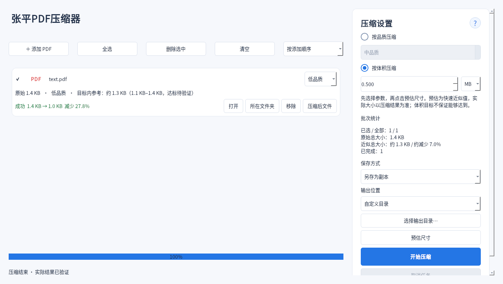
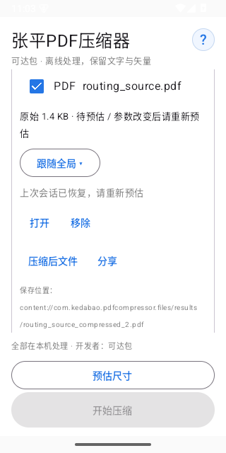

**因为某位友人公司常年有PDF压缩的需求，为了一次性解决他的问题，解放人形豆包，所以开发了这个软件。可以实现PDF的压缩，而且无需付费，也不会上传云端，全本地运行。win11 和android测试通过，android下没有过分索取权限，希望对你有帮助。部分第三方组件的使用如有侵权的部分请联系我删除，感谢。**

# 张平PDF压缩器

**开发者：可达包** · Windows x64 / Android · 全部在本机处理

一个蓝白风格的 PDF 批量压缩工具，支持按品质压缩、按每份文件的最大体积压缩，以及手动快速预估。优先优化 PDF 内嵌图片，保留文字、矢量和页面结构，不使用在线压缩 API，不默认将整页转换成图片。

**[下载最新程序](https://github.com/psybao/zhangping-pdf-compressor/releases/latest)** · [Android 说明](README_ANDROID.md) · [性能实测](docs/WINDOWS_PERFORMANCE_REPORT.md) · [第三方许可证](THIRD_PARTY_NOTICES.md)

## 直接使用，不需要开发环境

到 [Releases](https://github.com/psybao/zhangping-pdf-compressor/releases) 下载对应文件，不要把绿色 Code 按钮下载的源码当作安装程序。

|文件|用途|
|---|---|
|`ZhangPingPDF-Windows-x64.exe`|Windows 单文件版，双击即可使用，不需要安装 Python|
|`ZhangPingPDF-Windows-Setup.exe`|可选的当前用户安装包，创建桌面/开始菜单快捷方式和卸载入口|
|`ZhangPingPDF-Windows-Portable.zip`|Windows 便携目录版，解压后保留整个目录运行|
|`ZhangPingPDF-Android-debug.apk`|可安装的 Android Debug 签名 APK，兼容 ARM64|
|`ZhangPingPDF-Source-v1.0.0.zip`|整理后的完整应用源码及第三方许可文件|
|`SHA256SUMS.txt`|发行附件的 SHA-256 校验值|

Windows 目标平台为 Windows 10/11 x64，本次实际测试环境为 Windows 11。Android 最低 Android 8.0，本次实际测试为 Android 15 模拟器；其他版本和 ARM64 真机尚未完成实测。

## 如何使用

1. **添加 PDF**：点击添加按钮或在 Windows 拖入 PDF。支持批量导入，导入后不会自动执行压缩。
2. **压缩设置**：选择按品质或按体积模式，设置品质等级或每份文件的最大体积。未选模式的输入框显示灰色。
3. **预览**：点击“预估尺寸”，快速查看近似大小。预估只读取有限元数据，不执行完整压缩；更改参数后请重新预估。
4. **开始压缩**：确认保存方式和输出目录后点击“开始压缩”，查看进度和每份文件的成功/失败结果。

首次启动有四步引导，右上角圆形 `?` 可随时再次打开。

- **按品质**：高品质 / 中品质 / 低品质；每个文件也可单独选择品质。
- **按体积**：填写的是**每份 PDF 的硬上限**，不是整个批次总和。例如 2 MB = 2,097,152 字节，成功输出不得超过此上限。
- **体积预估**：预估值和参考范围不超过目标，属于“达标条件下的参考预览”，不保证任意文件都可压到目标。如果实际无法达到，显示未达标，不保存超限文件。
- **保存**：Windows 默认生成 `_compressed.pdf` 副本，同名自动加序号；也支持验证后的安全覆盖。Android 当前仅保存副本，可选择系统输出目录，默认结果位于应用专属目录。
- **打开文件**：“打开”在压缩前后都打开源文件；成功后新增的“压缩后文件”才打开输出结果。Android 另外支持分享结果。

## 界面

### Windows



### Android



## 速度优化实测

相同样本、冷候选缓存，原版与新版使用相同的图像质量阈值和编码器：

|场景|原版|优化后|
|---|---:|---:|
|扫描样本，目标 2 MB|47.82 秒 / 12 轮|11.65 秒 / 3 轮|
|混合样本，目标 500 KB|47.65 秒 / 12 轮|9.43 秒 / 4 轮|
|多图片 PDF，中品质|6.17 秒 / 单图片进程|3.93 秒 / 双图片进程|

以上样本输出字节数相同。体积模式从中品质开始探测、缩小参数区间，避免无条件跑满 12 轮。Windows 根据图片数量、像素量和可用内存，最多使用两个图片进程；不符合资源限制时使用单进程。单图片品质模式本次仍约 3.4 秒，没有明显加速。不同文件不会获得相同倍数的提升，详情和测量口径见[性能报告](docs/WINDOWS_PERFORMANCE_REPORT.md)。

## 从源码运行 Windows

需要 Python 3.11 x64、Git。以下命令在项目根目录的 PowerShell 执行：

```powershell
git clone https://github.com/psybao/zhangping-pdf-compressor.git
cd zhangping-pdf-compressor
python -m venv .venv
.\.venv\Scripts\python -m pip install -r requirements-dev.txt
.\.venv\Scripts\python app.py
```

只运行、不打包或测试时，可以改装 `requirements.txt`。压缩引擎使用 pdf-diet、pikepdf 内置 qpdf 和 Pillow，不需要额外安装 `qpdf.exe`。

## 构建 Windows 程序

```powershell
.\build_windows.ps1
```

输出到 `dist`：单文件 EXE、便携目录，以及安装程序。构建脚本清理 DLL 搜索路径，避免外部工具的 ICU DLL 污染 Qt 打包。

如存在 `tools/InnoSetup/ISCC.exe`，使用提供的 `installer.iss`；否则使用 Windows 自带 IExpress 和 Windows Script Host 生成当前用户安装包。系统禁用 Windows Script Host 时可直接使用单文件 EXE/便携版。

## 构建 Android APK

需要 **JDK 17**、Android SDK Platform 35、Build Tools 35.0.0。Gradle 8.9 wrapper 已包含在源码中，首次构建会联网下载依赖。

```powershell
$env:JAVA_HOME = 'C:\path\to\jdk-17'
$env:ANDROID_HOME = 'C:\path\to\Android\Sdk'
.\build_android.ps1
```

也可以在 Android Studio 打开 `android` 文件夹，并在 `android/local.properties` 设置本机的 `sdk.dir`。此文件、签名私钥和本机 SDK/JDK 不提交到 Git。

可安装的 Debug APK 位于 `android/app/build/outputs/apk/debug/app-debug.apk`。本发行版没有正式发布密钥，未签名 Release APK 不能直接安装；正式签名方法见 [README_ANDROID.md](README_ANDROID.md)。

## 测试

测试 PDF 是本项目生成的样本，不包含用户文档。为减小仓库，生成的 PDF 和构建缓存不提交，先在本地生成：

```powershell
.\.venv\Scripts\python prepare_test_fixtures.py
.\.venv\Scripts\python test_quick_estimate.py
.\.venv\Scripts\python test_target_cap.py
.\.venv\Scripts\python test_ui.py
.\.venv\Scripts\python test_engine.py
cd android
.\gradlew.bat :app:connectedDebugAndroidTest
```

Android 测试需要连接设备或启动模拟器。包含实际压缩、2 MB 上限、文字提取一致性、页面完整性、引导操作和源文件/结果文件打开 Intent 验证。历史测试摘要与性能数据在 `docs`；完整运行日志在开发者本机 `output`，不会作为源码发布。

## 限制与数据安全

- 所有 PDF 在本机处理，应用不上传用户文件；默认保留原文件，重要文档仍建议保留备份。
- 加密 PDF 和带签名字段的 PDF 拒绝修改，避免擅自解密或破坏数字签名。
- 有些主要由文字/矢量组成或已经高度压缩的 PDF 无法达到很小的目标体积。
- Android 不覆盖原件；SAF 单文件权限也不授予父目录权限，写共享位置需要用户选择目录。
- 取消会等待当前底层 PDF 操作结束；Android 被系统杀进程后恢复列表并提示任务中断，不自动继续压缩。
- 本发行 Windows EXE 未做 Authenticode 签名；Android APK 是 Debug 签名，不是商店正式签名版本。

## 技术与许可证

Windows：Python / PySide6 / pdf-diet / pikepdf（内置 qpdf）/ Pillow。Android：Kotlin / Compose Material 3 / Coroutines / PdfBox-Android。`product.json` 与 `shared/product.json` 定义统一参数，两端不要求输出字节相同。

第三方组件保持各自许可证，见 [THIRD_PARTY_NOTICES.md](THIRD_PARTY_NOTICES.md) 和 `licenses`。没有复制 AGPL 业务代码。Qt/PySide 按 LGPL 动态使用，提供可替换动态库的便携版、构建源码和对应源代码链接；相关修改与调试权利不受本项目限制。

项目自有代码目前未另行指定开源许可证；上传源码不改变第三方组件的授权条款。
